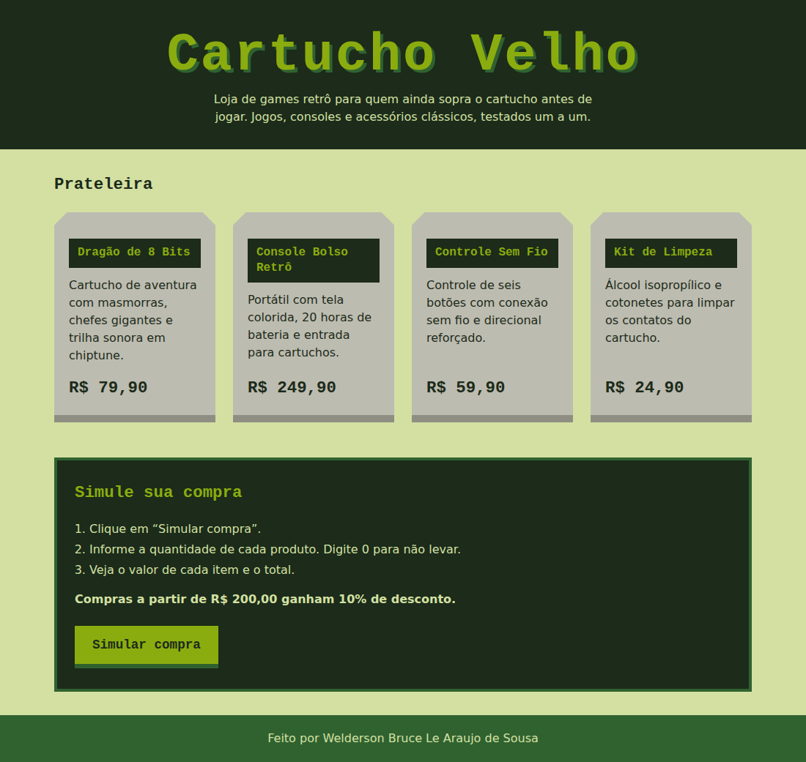

# Minha Loja: Simulador de Compras

**Projeto:** Cartucho Velho, loja fictícia de games retrô

**Aluno:** Welderson Bruce Le Araujo de Sousa

**Trilha:** Desenvolvimento Mobile

## Sobre a loja

A Cartucho Velho vende jogos, consoles e acessórios clássicos. A página mostra os produtos como cartuchos em uma prateleira e permite simular uma compra pelo botão "Simular compra".

### Produtos e preços

| Produto | Descrição | Preço |
|---|---|---|
| Dragão de 8 Bits | Cartucho de aventura com masmorras e chefes gigantes | R$ 79,90 |
| Console Bolso Retrô | Portátil com tela colorida e entrada para cartuchos | R$ 249,90 |
| Controle Sem Fio | Controle de seis botões com direcional reforçado | R$ 59,90 |
| Kit de Limpeza | Álcool isopropílico e cotonetes para os contatos | R$ 24,90 |

### Regra de desconto

Compras com total igual ou superior a **R$ 200,00** recebem **10% de desconto**.

## Como funciona a simulação

1. O botão chama `simularCompra()` pelo atributo `onclick`.
2. A função pergunta a quantidade de cada produto com `prompt()`.
3. As respostas são convertidas com `Number()`. Valores vazios, negativos, decimais ou não numéricos são recusados e a pergunta se repete.
4. O valor de cada produto é calculado (preço × quantidade).
5. Um `alert()` exibe quantidade e valor por produto, subtotal, desconto (se houver) e total.
6. Se todas as quantidades forem 0, o alerta informa que nenhum produto foi selecionado.

## Tecnologias

- HTML5
- CSS3 (Grid, `clip-path`, fontes Silkscreen e IBM Plex Sans do Google Fonts)
- JavaScript puro

## Como executar

1. Baixe ou clone o repositório.
2. Abra o arquivo `index.html` no navegador (não precisa de servidor nem de instalação).
3. Clique em "Simular compra" e responda aos `prompt()`.

## Estrutura

```
index.html
style.css
script.js
README.md
assets/
  captura-de-tela.png
```

## Captura de tela



## Testes realizados

| Cenário | Entrada | Resultado esperado | Resultado |
|---|---|---|---|
| Nenhum produto | 0, 0, 0, 0 | "Nenhum produto foi selecionado." | OK |
| Sem desconto | 2 cartuchos + 1 kit | Total R$ 184,70, sem desconto | OK |
| Com desconto | 1 console | R$ 249,90 − R$ 24,99 = R$ 224,91 | OK |
| Entrada inválida | `abc`, `-1`, `1.5`, vazio | Aviso e nova pergunta | OK |
| Cancelar | Cancelar no segundo `prompt()` | "Simulação cancelada." | OK |

## Dificuldade encontrada e aprendizado

**Dificuldade:** `Number("")` retorna `0` e `Number("abc")` retorna `NaN`, então uma resposta vazia seria aceita como "0 unidades" e uma letra quebraria o cálculo.

**O que aprendi:** é preciso validar a entrada do usuário depois de converter. Usei `trim()`, `Number.isInteger()` e a verificação `>= 0` dentro de um laço que repete a pergunta. Também aprendi que `prompt()` devolve `null` ao cancelar e que somar valores decimais em JavaScript gera imprecisões (como 239.70000000000002), então arredondei o total para centavos e formatei com `toLocaleString("pt-BR")`.
